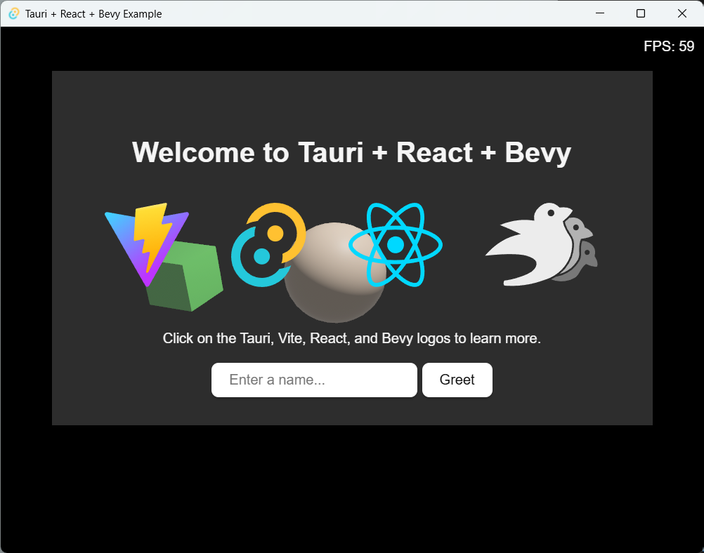

# Bevy + Tauri Example

This is an example of how to use Tauri as the window manager for a Bevy game.
Rendering everything native in bevy and using Tauri for the window management and UI elements.




## The Example

There are two different examples in the same codebase: wgpu and bevy.
If you want to run the wgpu example, you need to give additional flag as the following command after building the release version:

```bash
cd src-tauri/ && src-tauri/target/release/btexample --use-wgpu
```

## Development

This project is using the [Tauri](https://tauri.app/) framework for the window manager and UI elements. And the build tools from tauri-cli and yarn.

The Bevy example uses **Bevy 0.20.1** and requires **Rust 1.97.1 or newer**.
Tauri owns the window and event loop; Bevy's default plugins are initialized when
Tauri is ready, with `WinitPlugin` disabled and the renderer bound to the Tauri
window. The separate `--use-wgpu` example still uses wgpu 23.

On Linux, install the Tauri/Bevy development dependencies (Debian/Ubuntu):

```bash
sudo apt install build-essential pkg-config libgtk-3-dev libwebkit2gtk-4.1-dev libasound2-dev libudev-dev
```

To run a development server, you can use the following command:

```bash
yarn tauri dev
```

Build the release version:

```bash
yarn tauri build
```


## Recommended IDE Setup

- [VS Code](https://code.visualstudio.com/) + [Tauri](https://marketplace.visualstudio.com/items?itemName=tauri-apps.tauri-vscode) + [rust-analyzer](https://marketplace.visualstudio.com/items?itemName=rust-lang.rust-analyzer)

## Linux WebKit overlay

Linux uses a compatibility compositor in `src-tauri/src/linux_overlay.rs`:
WebKit renders a transparent viewport snapshot, which Bevy displays as a
full-window UI texture above the 3D scene. The original webview stays in place
and handles native mouse/keyboard input and Tauri IPC. Window resizing updates
both the viewport and texture. The page background stays transparent in dark mode.

Snapshot requests are asynchronous, capped at about 30 per second, and limited
to one in flight. Only the latest frame is retained, and unchanged pixel data
is not uploaded again. Cairo's premultiplied ARGB pixels are converted to
straight-alpha RGBA before upload. This CPU readback/upload path has a cost,
especially with large windows or software rendering; it is a compatibility
solution, not a zero-copy GPU compositor. Snapshot failures are logged once
until recovery.

Verified with Xvfb and Mesa software Vulkan: React and the animated Bevy scene
are visible together, FPS IPC updates, text entry and the Greet button work,
and resizing preserves the overlay. Unit tests cover alpha conversion, empty
snapshots, and texture resizing. Wayland, HiDPI, IME, and native webview popups
have not been verified. The standalone `--use-wgpu` example does not use this
Bevy compositor.

The original project at `a60fb86` (Bevy 0.15.1 and its original lockfile) also
fails to show the React overlay in the same Linux environment. It relies on
platform-native transparent WebView layering; the README screenshot shows
Windows. This Linux-specific path addresses that pre-existing limitation.
Windows and macOS use native WebView layering. On macOS, Tauri keeps the AppKit
event loop running continuously and drives Bevy at up to 60 Hz, allowing WebKit
to process page loads and input between frames. The transparent WebView layer
is explicitly placed above the Metal surface added by wgpu.

## Cross-platform desktop CI

The [desktop smoke workflow](.github/workflows/desktop-smoke.yml) builds and
runs the real app on Windows, macOS, and Linux. It checks final desktop pixels,
scene animation, native typing/clicking, Tauri IPC, and resizing, and uploads
screenshots plus logs. See [runner requirements and local commands](scripts/README.md).
